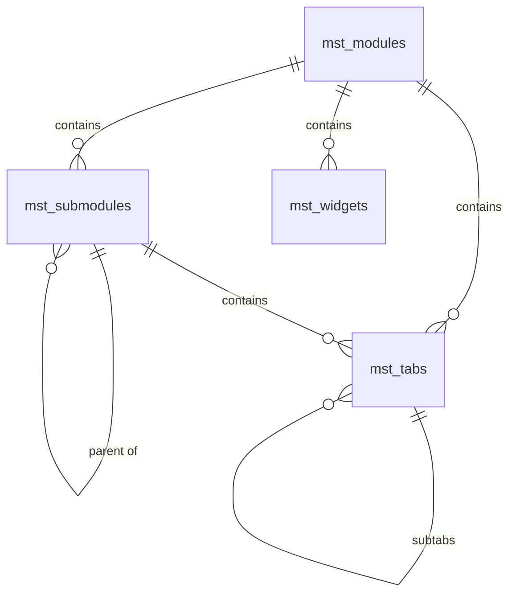

# Database Catalog & Schema Context

## 1. Catalog Tables (`schema: master`)

### Table Definitions:

1. **`master.mst_modules`**:
   - `Id` (UUID, PK)
   - `Code` (varchar(60), Unique)
   - `Name` (varchar(120))
   - `Route` (varchar(200), nullable)
   - `SortOrder` (integer)
   - `IconKey` (varchar(60))
   - `IsActive` (boolean)

2. **`master.mst_submodules`**:
   - `Id` (UUID, PK)
   - `ModuleId` (UUID, FK -> `mst_modules`)
   - `ParentId` (UUID, FK -> `mst_submodules`, nullable for nested hierarchies)
   - `Code` (varchar(60))
   - `Name` (varchar(120))
   - `Route` (varchar(200), nullable)
   - `SortOrder` (integer)
   - `IsActive` (boolean)

3. **`master.mst_tabs`**:
   - `Id` (UUID, PK)
   - `Code` (varchar(60), Unique)
   - `Name` (varchar(120))
   - `SortOrder` (integer)
   - `IsActive` (boolean)
   - `ModuleId` (UUID, FK -> `mst_modules`, nullable)
   - `SubModuleId` (UUID, FK -> `mst_submodules`, nullable)
   - `TabId` (UUID, FK -> `mst_tabs`, nullable for nested subtabs)
   - **Constraint (`CK_mst_tabs_OneParent`):** Exactly one of `ModuleId`, `SubModuleId`, or `TabId` must be non-null!

4. **`master.mst_widgets`**:
   - `Id` (UUID, PK)
   - `Code` (varchar(60), Unique)
   - `Name` (varchar(120))
   - `SortOrder` (integer)
   - `ModuleId` (UUID, FK -> `mst_modules`)
   - `IsActive` (boolean)

---

## 2. Authorization Tables (`schema: auth`)

1. **`auth.tbl_roles`**:
   - `Id` (UUID, PK)
   - `Name` (varchar(50), Unique)
   - `DisplayName` (varchar(100))
   - `IsActive` (boolean)
   - `IsSystemRole` (boolean)

2. **`auth.tbl_role_permissions`**:
   - `Id` (UUID, PK)
   - `RoleId` (UUID, FK -> `tbl_roles`)
   - `ItemId` (UUID - matches Module, Submodule, Tab, or Widget ID)
   - `CanView` (smallint: 0 or 1)
   - `CanManage` (smallint: 0 or 1)
   - `CreatedAtUtc`, `UpdatedAtUtc`

3. **`auth.log_role_permission_audits`**:
   - Audit trail capturing who modified permissions, previous values, and new values.

