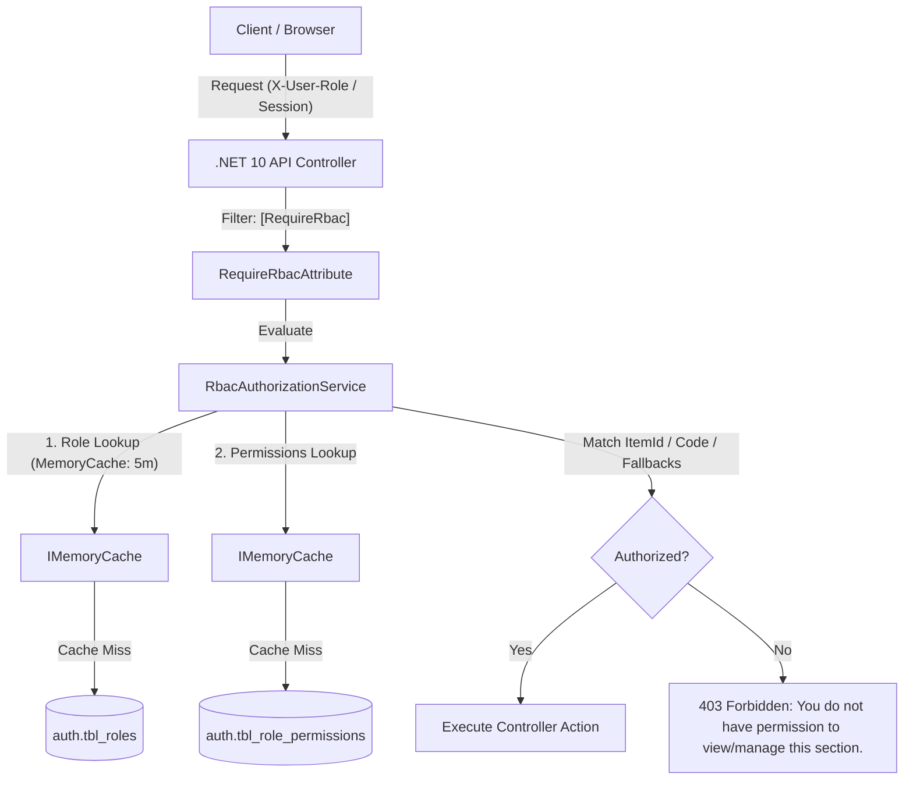

# RBAC Architecture & Implementation

## 1. High-Level Flow



---

## 2. Backend Components

### 1. `RequireRbacAttribute`
Located at `apps/backend/Infrastructure/Authorization/RequireRbacAttribute.cs`:
- Attachable to Controllers or individual Action methods.
- Accepts `ItemCodeOrId` (string or GUID), `AccessType` (`RbacAccessType.View` or `RbacAccessType.Manage`), and optional `params string[] fallbackCodes`.
- Evaluates `IRbacAuthorizationService.HasAccessAsync`. If the primary check fails, iterates through `fallbackCodes`.
- If unauthorized, returns HTTP 403 Forbidden with payload:
  ```json
  {
    "data": null,
    "meta": null,
    "errors": [
      {
        "code": "FORBIDDEN",
        "field": null,
        "message": "You do not have permission to view this section." // or manage
      }
    ]
  }
  ```

### 2. `RbacAuthorizationService`
Located at `apps/backend/Infrastructure/Authorization/RbacAuthorizationService.cs`:
- Resolves the caller's role from Claims (`ClaimTypes.Role`) or `X-User-Role` header.
- **Admin Bypass**: If role name is `"Admin"` (case-insensitive), returns `true` immediately.
- Caches Role ID lookups (`rbac_role_id_{role}`) and Permission maps (`rbac_perms_{roleId}`) for 5 minutes.
- Evaluates:
  - `RbacAccessType.View`: satisfied if `p.CanView == 1 || p.CanManage == 1`.
  - `RbacAccessType.Manage`: satisfied only if `p.CanManage == 1`.
- **Unconfigured Role Fallback**: If `perms.Count == 0` (no rows in `auth.tbl_role_permissions` for this role):
  - View access defaults to `true` for standard modules (to allow newly created roles basic navigation before admin tuning).
  - Manage access defaults strictly to `false`.
  - Strict security modules (`repository`, `settings`, `master`, `roles-permissions`) default strictly to `false`.
- **Configured Role Restriction**: If `perms.Count > 0` (the admin has saved permissions for this role):
  - Any item not present in `perms` defaults strictly to `false` (revoked/unselected).

---

## 3. Frontend Components

### 1. `PermissionProvider` & `usePermissions`
Located at `apps/frontend/src/lib/permissions.tsx`:
- Fetches active role permissions on mount and when role changes (`/api/v1/auth/roles/{roleId}/permissions`).
- Re-fetches on global `"permissions-updated"` CustomEvent (triggered whenever permissions are saved in Settings).
- Exposes helper methods:
  - `canView(codeOrId: string): boolean`
  - `canManage(codeOrId: string): boolean`
  - `hasPermission(key: string): boolean`
  - `hasAny(...keys): boolean`
  - `hasAll(...keys): boolean`

### 2. Hierarchical Inheritance
- If a parent submodule or module is disabled, all children automatically evaluate to `false` unless configured as independent containers (e.g. `action-centre`).
- Top-level settings and masters are hardcoded to `activeRoleName === "admin"`.
- Detail pages (`employee-detail`, `customer-detail`, `project-detail`) inherit permissions from their parent module if not explicitly configured.

---

## 4. Cache Invalidation
When an administrator modifies permissions in **Settings -> Roles & Permissions**:
1. Frontend calls `PUT /api/v1/auth/roles/{id}/permissions`.
2. Backend updates `auth.tbl_role_permissions`, logs audit trail in `auth.log_role_permission_audits`, and calls `IRbacAuthorizationService.InvalidateRoleCache(roleId)`.
3. Frontend dispatches `window.dispatchEvent(new Event("permissions-updated"))`.

